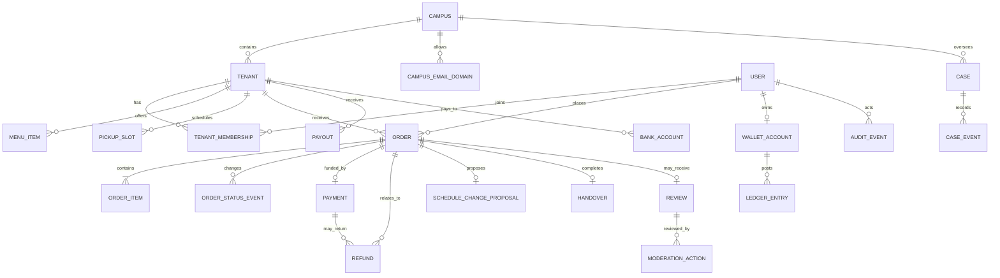

# Antriin — Requirements Produk & API

**Basis:** prototype native `antriin-pilot-v17-complete.figcraft`, berstatus *Current Completeness Release* di `DESIGN.md` (11 Nov 2026). V17 mencakup 12 halaman, 106 layar aplikasi kanonis dan 134 frame/komponen utama yang diaudit. Dokumen ini menerjemahkan alur produk menjadi kebutuhan backend; ini bukan klaim bahwa API sudah ada.

> **Catatan versi:** `PRODUCT.md` masih memuat deklarasi awal yang menyebut `pilot-v6` dan `unified-v4`, sedangkan `DESIGN.md` dan `outputs/complete-v17/README.md` menandai V17 sebagai rilis kelengkapan terkini. Dokumen ini mengikuti V17 untuk cakupan layar dan `PRODUCT.md` untuk aturan produk yang masih relevan. Prototype menampilkan data contoh; semua transaksi, saldo, AI, notifikasi, verifikasi dan aksi belum terhubung ke layanan nyata.

## 1. Tujuan dan prinsip produk

Antriin adalah pemesanan makanan kampus untuk diambil sendiri pada waktu yang dipilih. Pembeli memilih tenant, menu, opsi hidangan dan waktu pengambilan; membayar melalui saldo AntriPay saat checkout; tenant mengonfirmasi kesanggupan; makanan disiapkan mendekati waktu yang disepakati; lalu petugas memvalidasi kode dan mencatat serah terima.

Aturan yang harus selalu dijaga:

1. Pesanan dibayar **sebelum** tenant menerima atau menyiapkan pesanan. Pembayaran menu hanya dari AntriPay. QRIS digunakan untuk **top-up AntriPay**, bukan membayar pesanan setelah diterima.
2. Pembayaran berhasil tidak sama dengan dana tenant yang sudah tersedia untuk dicairkan.
3. Pesanan berjumlah besar dibanding pola tenant diberi indikasi untuk ditinjau; besar saja bukan bukti pesanan fiktif.
4. Perubahan jadwal/jumlah/harga setelah checkout memerlukan persetujuan eksplisit pembeli. Batas waktu tanggapan habis tidak memicu produksi otomatis.
5. Pembatalan/refund karena kendala operasional ditinjau pengelola. Saldo pembeli bertambah kembali hanya setelah penyedia pembayaran mengonfirmasi refund berhasil.
6. Skor/indikasi AI membantu menyortir peninjauan, bukan keputusan pelanggaran. Keputusan manusia, alasan, aktor dan waktunya dicatat.
7. Ulasan hanya untuk pesanan selesai/diambil dan akun dengan email kampus terverifikasi; satu ulasan per pesanan. Tenant tidak dapat menghapus ulasan pembeli.
8. Rekomendasi hanya memakai menu nyata yang tersedia, harga, preferensi serta ulasan pesanan selesai yang terverifikasi. AI tidak membuat rating fiktif.
9. Tidak ada split bill, badge atau gamifikasi dalam cakupan rilis ini.

## 2. Peran, tenancy, dan izin

Semua otorisasi ditegakkan di server pada setiap objek dan aksi (RBAC + pemeriksaan kepemilikan/tenant/campus). Menyembunyikan tombol di aplikasi bukan kontrol akses.

| Kapabilitas | Pembeli | Pemilik tenant | Staf dapur | Petugas pengambilan | Pengelola kampus |
|---|---|---|---|---|---|
| Lihat menu/tenant aktif | Publik | Tenant sendiri | Tenant sendiri | Tenant sendiri | Kampus sendiri/semua dalam cakupan tugas |
| Membuat/mengelola pesanan | Milik sendiri | Lihat & proses tenant sendiri | Lihat & proses sesuai tugas | Lihat pesanan untuk validasi ambil | Pantau; tidak membuat atas nama pembeli |
| Ubah menu, jam, kapasitas, staf | Tidak | Kelola tenant sendiri | Sesuai izin; bukan peran default | Tidak | Kelola data tenant kampus bila diberi izin |
| Terima pesanan / tandai disiapkan | Tidak | Ya | Ya, penerimaan/dapur | Tidak | Tidak |
| Validasi kode & catat serah terima | Tidak | Dapat memantau | Tidak default | Ya | Tidak |
| Lihat saldo, transaksi, laporan tenant | AntriPay sendiri | Keuangan tenant sendiri | Tidak | Tidak | Pantau transaksi/pencairan kampus sesuai izin |
| Kelola rekening / ajukan pencairan | Tidak | Ya, pemilik terverifikasi | Tidak | Tidak | Pantau; bukan persetujuan manual tiap pencairan |
| Top-up dan bayar | Akun sendiri | Tidak sebagai pemilik tenant | Tidak | Tidak | Tidak |
| Tulis/ubah/hapus ulasan sendiri | Ya, jika eligible | Tidak | Tidak | Tidak | Moderasi sesuai izin |
| Balas ulasan tenant | Tidak | Ya | Sesuai izin | Tidak | Pantau/moderasi |
| Laporkan kendala tenant | Tidak | Ya | Ya sesuai tugas | Ya sesuai tugas bila berwenang | Tinjau/tindaklanjuti |
| Setujui pembatalan / inisiasi refund | Meminta bantuan; bukan mengeluarkan dana | Mengajukan laporan/konteks, bukan memutus sendiri | Tidak | Tidak | Ya, untuk kampus dalam penugasan |
| Moderasi ulasan / tinjau indikasi AI | Tidak | Tidak | Tidak | Tidak | Ya, menurut izin dan ruang lingkup |
| Kelola akun/role/izin | Profil sendiri | Staf tenant sendiri; tidak dapat memberi akses keuangan pemilik | Tidak | Tidak | Akun kampus, domain verifikasi dan role kampus sesuai izin |

### Role dan scope yang diperlukan

- **Buyer:** terikat ke `user_id`; pesanan, wallet, top-up, review dan profil hanya milik sendiri.
- **Tenant owner:** terikat ke satu atau lebih `tenant_id`; pemilik memiliki menu, konfigurasi, staf, laporan dan fungsi finansial tenant. Rekening dan pencairan hanya pemilik terverifikasi.
- **Kitchen staff:** scope tenant; izin minimum dapat mencakup melihat antrean, menerima pesanan, memulai/menandai persiapan, jeda order, lapor kendala, ubah menu/jam/kapasitas, balas ulasan—berdasarkan izin eksplisit yang diberikan pemilik. Tidak memiliki akses rekening atau pencairan.
- **Pickup staff:** scope tenant; melihat pesanan siap yang diperlukan, memvalidasi kode dan mencatat serah terima. Tidak mengubah rekening, melakukan pencairan, atau mengelola menu/keuangan.
- **Campus manager/admin:** scope `campus_id` dan/atau penugasan. Izin terpisah untuk ringkasan/pantauan transaksi, tenant, akses, payout, tinjauan kasus/refund, moderasi ulasan dan pengelolaan domain email kampus. UI memperlihatkan role/izin granular, bukan satu hak superuser implisit.
- **System/service principals:** webhook pembayaran, email/OTP, notifikasi, analisis indikasi; kredensial mesin terpisah dari role manusia, dibatasi ke aksi layanan tertentu.

**Izin granular yang disarankan:** `tenant.orders.read`, `tenant.orders.accept`, `tenant.orders.prepare`, `tenant.orders.handover`, `tenant.orders.pause`, `tenant.menu.manage`, `tenant.capacity.manage`, `tenant.staff.manage`, `tenant.reviews.reply`, `tenant.sales.read`, `tenant.finance.read`, `tenant.bank_account.manage`, `tenant.payout.request`, `campus.transactions.read`, `campus.tenants.manage`, `campus.access.manage`, `campus.reviews.moderate`, `campus.cases.read`, `campus.cases.decide`, `campus.refunds.initiate`, `campus.payouts.read`, `campus.ai_reviews.decide`, `campus.audit.read`. Ini rekomendasi implementasi; prototype tidak mendefinisikan nama permission API final.

## 3. Alur lengkap per domain

### 3.1 Identitas, masuk, verifikasi email kampus

1. Pengunjung dapat menjelajah menu; untuk checkout/akun, mulai masuk dengan nomor WhatsApp atau email kampus sesuai layar.
2. Server mengirim kode OTP; simpan hanya hash OTP, expiry, jumlah percobaan, waktu kirim ulang dan tujuan yang dinormalisasi. Kode contoh di prototipe bukan kredensial produksi.
3. Validasi kode membuat/mengautentikasi akun dan menerbitkan sesi/token. OTP akun dan verifikasi email kampus untuk ulasan adalah tujuan/claim terpisah.
4. Untuk menulis ulasan, pembeli memasukkan email pada domain kampus yang diizinkan; kirim kode verifikasi, tangani kode salah/kedaluwarsa/kirim ulang, lalu tandai `campus_email_verified_at`.
5. Profil menunjukkan nama, nomor akun, status email kampus, saldo AntriPay, riwayat pesanan dan pintasan bantuan. Perubahan nomor/email perlu verifikasi ulang. Preferensi notifikasi perangkat merupakan kontrol klien.

Kebutuhan: rate limit OTP per identitas/IP/perangkat, cegah enumerasi akun, batas percobaan dan cooldown, revoke sesi, pencatatan perangkat/sesi, persetujuan dan retensi data. Masa berlaku, kebijakan multi-perangkat, provider OTP dan kebijakan akun belum ditentukan.

### 3.2 Penemuan, tenant, menu dan rekomendasi

1. Beranda menampilkan kantin/menu nyata yang buka atau akan buka, rekomendasi, pilihan hemat/anggaran, pencarian/kategori, ulasan dan status ketersediaan.
2. Halaman tenant menampilkan nama, lokasi kampus/gedung/lantai, jam buka, status buka/tutup/jeda, estimasi pengambilan, rating dari ulasan eligible, kategori dan menu.
3. Item menu menampilkan nama, deskripsi/bahan atau catatan hidangan, harga, foto, kategori, ketersediaan/stockout dan opsi khusus (contoh tingkat/cara sambal).
4. Rekomendasi mempertimbangkan menu yang sedang aktif/tersedia, harga/budget, preferensi dan ulasan terverifikasi. Sumber dan versi rekomendasi dapat ditelusuri; jangan mengarang rating.
5. Saat menu habis, item tidak bisa ditambahkan/checkout. Tenant dapat mengubah ketersediaan tanpa menghapus riwayat transaksi.

### 3.3 Keranjang, jadwal, checkout dan pembayaran pesanan

1. Pembeli memilih menu, kuantitas, opsi dan catatan khusus; item masuk ke keranjang untuk satu tenant (asumsi API awal; aturan multi-tenant per checkout belum disepakati).
2. Pilih tanggal dan slot waktu pengambilan yang masih dibuka. Setiap slot mempunyai kapasitas; kapasitas penuh/toko tutup menolak pemilihan dan menawarkan pilihan lain.
3. Checkout memvalidasi ulang harga, menu aktif, stock/kapasitas, jam operasional, opsi, jumlah, waktu dan nilai total di server. Ringkasan checkout tidak dapat menjadi sumber harga tepercaya.
4. Pembeli mengonfirmasi ringkasan: tenant, item/opsi/kuantitas, catatan, waktu/lokasi pengambilan, total dan saldo AntriPay.
5. Jika saldo kurang, jangan buat pembayaran sebagian/utang; kembalikan saldo kurang dan sediakan alur top-up. Jika cukup, reserve kapasitas dan debet wallet secara atomik; buat order + payment ledger dengan idempotency key.
6. Tampilkan pembayaran sukses dan status `paid_awaiting_tenant`; kirim notifikasi ke tenant. Jika provider/wallet belum final, tampilkan status memeriksa pembayaran; jangan duplikasi debit atau order ketika retry.
7. Halaman riwayat/detail menampilkan status, rincian immutable saat dibayar, referensi pembayaran, tenant dan waktu ambil. Pembeli dapat membuka bantuan untuk masalah pembayaran, perubahan atau keterlambatan.

Rumus komponen harga, pajak, fee, batas pembelian, masa tahan slot dan apakah satu keranjang lintas tenant boleh harus dikunci sebelum implementasi.

### 3.4 Penerimaan tenant, persiapan dan pengambilan

1. Antrean tenant menampilkan order berbayar, kode/ID, daftar dan opsi item, jumlah, catatan khusus, waktu ambil, pembeli secukupnya untuk operasional, dan total dibayar.
2. Pemilik/staf yang berizin memeriksa bahan, kapasitas dapur dan waktu. Terima pesanan bila sanggup; jika tidak sanggup, laporkan kendala atau ajukan perubahan jadwal. Tidak boleh memulai persiapan sebelum pembayaran berhasil.
3. Setelah diterima, status menjadi `accepted_scheduled`/`confirmed`; terjadwal ditahan sampai waktu persiapan yang relevan. Aksi dapur: `preparing` → `ready_for_pickup`.
4. Pembeli diberi pembaruan status dan instruksi lokasi. Saat siap, aplikasi menampilkan kode pengambilan spesifik order.
5. Petugas pengambilan memasukkan/memindai kode, server memvalidasi tenant/order/status/kadaluarsa/duplikasi, lalu mencatat petugas dan waktu handover. Tampilkan penyerahan tercatat dan tandai order selesai.
6. Tidak ada pembayaran kedua saat pengambilan. Handover idempotent; kode tidak boleh dipakai untuk tenant/order lain atau digunakan dua kali.
7. Jika perangkat dapur offline: antrekan perubahan lokal dapat tersinkron; API harus menangani retry, event idempotent, konflik status dan indikator waktu sinkronisasi. Prototype hanya menunjukkan layar offline/synced; protokol offline perlu didefinisikan.

### 3.5 Pesanan besar dan usulan perubahan

1. Sistem dapat membuat `large_order_flag` berdasar jumlah relatif pada pola tenant dan mencatat alasan/versi model; jangan memblokir otomatis atau menyebutnya kecurangan.
2. Tenant melihat jumlah, total, ambil kapan dan alasan indikasi; dapat menyanggupi, menyatakan tidak sanggup, melaporkan kendala, atau mengusulkan waktu baru.
3. Usulan perubahan disimpan sebagai proposal dengan nilai lama/baru, alasan, pembuat, tenggat dan status `pending_buyer` (prototype menunjukkan contoh perubahan waktu, jumlah/total tetap).
4. Pembeli menyetujui atau menolak. Terima mengubah jadwal hanya jika slot baru valid dan aksi masih dalam state yang sama; tolak membuat usulan `rejected` dan merutekan ke tinjauan pengelola jika diperlukan.
5. Timeout menjadi `expired`; tidak boleh menafsirkan sebagai persetujuan, menerima pesanan atau memulai persiapan. Beri pengelola jalur peninjauan pembatalan/refund.
6. Lindungi replay: keputusan hanya satu kali, nilai proposal immutable setelah diputus, concurrency memakai versi/state precondition.

### 3.6 Jeda tenant dan laporan kendala

1. Pemilik/staf berizin dapat menjeda penerimaan order baru, mengubah estimasi/jam/kapasitas dan melaporkan jenis kendala (contoh bahan habis, gas habis, alat bermasalah) serta keterangan.
2. Laporan terikat ke tenant/order, berisi kategori, catatan, lampiran bukti opsional, aktor/waktu. Pengiriman dapat sekaligus menjeda order baru.
3. Kendala menjadi konteks untuk investigasi, bukan kekebalan dari pemeriksaan pola pembatalan berulang. Order yang sudah dibayar tetap perlu keputusan manusia.
4. Pengelola dapat meminta keterangan tambahan atau menyetujui pembatalan. Keputusan memicu proses refund, bukan langsung menambah saldo.

### 3.7 AntriPay: wallet, top-up, transaksi dan refund

1. Wallet buyer menampilkan available balance, transaksi bertipe dan detail setiap transaksi.
2. Top-up: pilih nominal dan QRIS; buat payment intent/provider reference/expiry, tampilkan status `pending`, `success`, `failed` atau `expired`; hanya callback provider tervalidasi yang mengkredit wallet. Bukti transaksi mencakup metode, tujuan, nominal dan referensi top-up.
3. Pembayaran order menghasilkan entri debit dan referensi transaksi terpisah dari ledger settlement tenant.
4. Refund: permintaan → ditinjau pengelola → disetujui/inisiasi → menunggu provider → berhasil/gagal/perlu bantuan. Hubungkan dengan order dan payment asli; gunakan referensi refund tetap untuk penelusuran; mencegah refund ganda.
5. Kredit refund ke AntriPay hanya sesudah provider mengonfirmasi sukses. UI status “diproses” tidak berarti saldo sudah kembali. Gangguan/kegagalan dapat masuk antrean bantuan dan rekonsiliasi.
6. Ledger immutable dan double-entry: setiap mutasi saldo memiliki debit/kredit seimbang, referensi unik, currency, amount integer dalam satuan terkecil, waktu, tipe, status dan sumber. Saldo adalah hasil ledger/akun tersimpan yang konsisten, bukan angka bebas dari klien.
7. Rekonsiliasi webhook dan retry harus aman; verifikasi signature, deduplicate provider event, simpan payload terkontrol, alarm ketidaksesuaian dan alur manual berjejak audit.

### 3.8 Keuangan, laporan dan pencairan tenant

1. Ringkasan keuangan tenant memisahkan pembayaran masuk, refund yang telah berhasil, pesanan terjadwal/belum selesai, pesanan selesai dan dana tersedia untuk dicairkan.
2. Pembayaran sukses belum tentu settlement tersedia; aturan kapan dana dilepas (mis. handover/settlement provider, reserve, chargeback) belum ditetapkan dan harus dimodelkan terpisah.
3. Pemilik tenant melihat transaksi, detail, status, biaya dan pencairan; pemilik mengelola rekening terverifikasi dan mengajukan pencairan dari dana tersedia.
4. Staf dapur/pengambilan tidak boleh melihat rekening sensitif, mengganti rekening atau mengajukan pencairan.
5. Perubahan rekening memerlukan verifikasi ulang pemilik dan audit; perubahan tidak mengubah tujuan payout yang sudah diproses.
6. Payout memiliki status diminta, diproses, berhasil, gagal; simpan jumlah, biaya, tujuan tersamarkan, referensi provider, kegagalan, waktu dan riwayat. Dana baru dianggap masuk rekening sesudah sukses.
7. UI menyebut alur pencairan tenant tidak memerlukan approval manual kampus tiap transaksi. Pengelola kampus dapat memantau payout sesuai izin.
8. Laporan penjualan dapat mencakup rentang tanggal dan pemisahan total/status. Definisi gross/net, fee, pajak, ekspor dan waktu settlement belum diputuskan.

### 3.9 Ulasan, verifikasi dan moderasi

1. Setelah order selesai/handover, buyer terverifikasi kampus dapat membuat satu ulasan/order, rating dan teks; validasi hubungan buyer/order/tenant dan status.
2. Edit/hapus hanya ulasan milik sendiri sesuai kebijakan; layar hapus meminta konfirmasi dan menjelaskan riwayat pesanan/pembayaran tetap ada.
3. Tenant dapat membaca dan membalas, tetapi tidak dapat menghapus atau mengedit ulasan pembeli.
4. Ulasan publik tidak menampilkan alamat email lengkap; lakukan redaksi data pribadi dan sediakan pelaporan.
5. Pengelola dengan izin moderasi memeriksa laporan, alasan, cuplikan tersamarkan, bukti kaitan pesanan, lalu memilih pertahankan/sembunyikan dan mencatat alasan. Rating rendah sendiri bukan pelanggaran.
6. Indikasi lonjakan rating (contoh perubahan 3.5 ke 4.9 dengan 30 ulasan dalam 5 menit) masuk antrean review; bukan auto-hide/ban.

### 3.10 Pengelolaan kampus, tenant, akses dan peninjauan AI

1. Dashboard kampus merangkum transaksi, payout, tenant, kasus, kendala, refund dan indikasi AI dengan filter kampus/rentang/status.
2. Admin berizin membuat/mengubah tenant (identitas, lokasi, kontak/status), mengelola staf/akses serta domain email kampus yang diizinkan. Kepemilikan domain tetap harus diverifikasi.
3. Admin melihat transaksi/payout dan detail sebagai pantauan/investigasi; kemampuan memindah dana tidak otomatis diberikan.
4. Antrean AI mencakup kategori rating, rangkaian top-up-pembayaran-refund, perubahan status/cancel tenant, dengan skor, alasan/sinyal, periode, referensi bukti dan status tinjauan.
5. Pengelola memeriksa bukti, dapat meminta penjelasan atau menandai selesai tanpa pelanggaran, dan mencatat keputusan + alasan. Skor AI tidak boleh menjadi dasar sanksi otomatis.
6. Audit trail menyimpan actor, role/scope saat aksi, target, aksi, timestamp, reason, before/after yang perlu, correlation ID dan sumber (human/service). Riwayat keputusan dapat dibaca sesuai izin.

## 4. Siklus status kanonis

Implementasi harus menolak transisi ilegal di server. Simpan waktu per transisi dan aktor; hindari satu status umum yang menutupi status pembayaran/refund/fulfillment.

| Entitas | Status inti yang disarankan | Transisi/aturan |
|---|---|---|
| Order | `awaiting_payment` → `paid_awaiting_tenant` → `confirmed` → `preparing` → `ready_for_pickup` → `completed`; cabang `declined` atau `cancelled` | Dibuat/debit setelah pembayaran berhasil; tenant menerima; dapur; siap; handover tervalidasi. Penolakan/kendala setelah dibayar perlu jalur case/refund yang diizinkan; `cancelled` hanya melalui keputusan yang sah. |
| Payment | `pending`, `succeeded`, `failed`, `expired`, `reversed` | Provider/wallet; idempotent, terpisah dari order dan settlement. |
| Schedule proposal | `pending_buyer`, `accepted`, `rejected`, `expired`, `cancelled` | Keputusan pembeli hanya sekali; timeout bukan accept. |
| Incident/case | `reported`, `under_review`, `awaiting_information`, `approved_cancel`, `declined`, `resolved` | Laporan, pemeriksaan, permintaan bukti/keputusan manusia. |
| Refund | `requested`, `under_review`, `submitted`, `processing`, `succeeded`, `failed`, `needs_assistance` | Saldo baru dikredit pada `succeeded`; satu refund per maksud pembayaran/aturan parsial yang belum diputuskan. |
| Top-up | `created`, `pending`, `succeeded`, `failed`, `expired` | Kredit wallet hanya saat sukses terverifikasi. |
| Payout | `requested`, `processing`, `succeeded`, `failed`, `cancelled` | Pemilik meminta; provider memproses; update saldo payable sesuai aturan settlement. |
| Menu/tenant | `active`, `sold_out`/`unavailable`, `archived`; tenant `open`, `closed`, `paused` | Perubahan availability/jam/kapasitas berlaku untuk order baru; tidak mengubah snapshot order lama. |
| Review/moderation | `visible`, `reported`, `under_review`, `hidden`, `resolved` | Tenant tidak punya transisi delete/moderasi; hanya pengelola berizin. |

Nama final dan state khusus perlu dibakukan sebelum kontrak API dibuat. Bila refund gagal setelah cancel, order tetap cancelled tetapi dana/status refund masuk bantuan; jangan kembalikan ke saldo tanpa konfirmasi.

## 5. Inventaris fitur/layar yang dicakup V17

Daftar ini mencatat layar produk yang ada dalam manifest kanonis (106 layar), diringkas menurut alur supaya tidak menyamakan frame referensi/UI kit dengan fitur backend. Nama layar contoh yang memakai data seperti A-014 atau Rp50.000 adalah konten demonstrasi, bukan ID atau tarif tetap.

| Area | Layar/fitur yang terlihat |
|---|---|
| Pembeli & discovery | Welcome/jelajah; beranda “Makan pas waktunya”; kantin/menu dan kategori; rekomendasi; filter anggaran; detail menu dan pilihan sambal; keranjang, kondisi kosong, ubah isi keranjang; lokasi tenant/pengambilan; ringkasan pesanan; permintaan/catatan khusus; pilih jadwal; checkout; saldo kurang; pembayaran berhasil; jadwal terkonfirmasi; pesanan dibayar-menunggu tenant; persiapan; siap diambil; tiket/kode pickup; order selesai; bantuan pesanan; jeda/tenant tutup; menu habis. |
| Identitas & profil | Login email kampus/WhatsApp; kirim OTP; OTP salah/benar/kirim ulang; akun siap; profil; pesanan/riwayat; pesanan sebelumnya/pesan lagi; status verifikasi kampus; informasi saldo AntriPay; pengaturan notifikasi perangkat. |
| AntriPay & pembayaran | Wallet; pilih/buat top-up; top-up QRIS; top-up pending/berhasil/gagal/kedaluwarsa; daftar/detail transaksi; order payment pending/berhasil/gagal; saldo kurang; refund review/pending; refund processing; refund success; refund needs assistance; referensi penelusuran refund. |
| Ulasan & verifikasi kampus | Daftar/lihat ulasan; review terkunci jika belum verified; kirim email kampus; OTP kode kampus; email salah; verified; editor ulasan; ulasan terkirim; konfirmasi hapus ulasan beserta preview. |
| Operasional tenant | Antrean pesanan masuk; konfirmasi kesanggupan; status terkonfirmasi; dapur mulai menyiapkan; siap diserahkan; serah terima tercatat; pesanan besar dan alasan indikasi; tidak sanggup; usulan perubahan jadwal; menunggu keputusan pembeli; diterima/ditolak/expired; laporan kendala; kendala terkirim dan order baru dijeda; perangkat dapur offline/antrean tersinkron; notifikasi/ringtone; pengaturan kantin, estimasi/jam, kapasitas; staf dan izin; menu/tambah/edit/simpan/validasi harga/arsip; ketersediaan menu/sold-out; balas ulasan. |
| Keuangan tenant | Ringkasan; daftar transaksi; detail transaksi; saldo tersedia; form pencairan; konfirmasi pengajuan; daftar payout; detail payout/timeline; rekening payout dan status verifikasi; payout gagal; laporan penjualan dan pemisahan pembayaran masuk/refund/order status. |
| Pengelola kampus | Dashboard; daftar/detail transaksi; daftar/detail pencairan; daftar/form tenant; kelola role/akses/domain email kampus; antrean kasus kendala/refund; tinjau dan putuskan pembatalan; pantau refund dan hasil penelusuran; antrean sinyal AI; detail lonjakan rating; detail anomali AntriPay; detail aktivitas tenant; minta penjelasan/tandai selesai tanpa pelanggaran; moderasi ulasan (pertahankan/sembunyikan) dan keputusan tercatat. |

Prototype juga berisi halaman identitas Ntri, role/alur, komponen, ticket study, UI kit dan pola vektor sebagai referensi presentasi; itu bukan endpoint/domain tambahan kecuali fitur produk yang dirinci di tabel dan flow di atas.

## 6. Model data/domain minimum

Semua record memakai ID opaque, `created_at`, `updated_at`, timezone eksplisit, dan `campus_id`/`tenant_id` yang relevan. Uang integer unit terkecil + ISO currency. Catatan transaksi bersifat snapshot.

- **Identity:** `User`, `Session`, `OtpChallenge`, `CampusEmailVerification`, `Device/NotificationPreference`.
- **Campus & tenancy:** `Campus`, `AllowedEmailDomain`, `Tenant`, `TenantMembership`, `Role`, `Permission`, `StaffInvite`.
- **Catalog:** `MenuItem`, `MenuOption/Choice`, `MenuCategory`, `OperatingHours`, `PickupSlot`, `SlotCapacity`, `AvailabilityOverride`.
- **Order:** `Cart` (opsional server-side), `Order`, `OrderItemSnapshot`, `OrderOptionSnapshot`, `Schedule`, `OrderStatusEvent`, `PickupCode`, `Handover`.
- **Payment:** `WalletAccount`, `LedgerEntry` (double-entry), `TopUp`, `Payment`, `PaymentProviderEvent`, `Settlement/Payable`, `Payout`, `BankAccount` (terenkripsi/tokenisasi; masking di respons).
- **After-sales:** `ScheduleChangeProposal`, `IncidentReport`, `Case`, `Refund`, `SupportReference`.
- **Trust:** `Review`, `ReviewReport`, `ModerationAction`, `RiskSignal`, `RiskReviewDecision`.
- **Platform:** `Notification`, `AuditEvent`, `IdempotencyRecord`, `OutboxEvent`.

Jangan menyimpan OTP plaintext, data rekening mentah tanpa perlindungan, nomor/email lengkap di output publik, atau data kartu/QR sebagai bukti final. File bukti/lampiran perlu akses terotorisasi, tipe/ukuran batas dan masa retensi.

## 7. Requirements database

Database utama yang disepakati adalah **PostgreSQL**, dengan **Drizzle ORM dan migrasi SQL**. Model relasional/ACID digunakan untuk akun, order, wallet, ledger, refund, payout dan audit karena aturan integritas lintas tabel penting. Data analitik/AI boleh direplikasi ke storage analitik terpisah; sumber kebenaran transaksi tetap di PostgreSQL. Semua tabel tenant-scoped wajib membawa relasi tenant/kampus yang dapat divalidasi server. Konvensi skema di bawah menjadi acuan implementasi PostgreSQL; stack lengkap ada di bagian 14.

### 7.1 Konvensi skema

- Gunakan primary key opaque yang tidak mengekspos urutan/jumlah transaksi (UUID/ULID atau setara); jangan gunakan nomor urut sebagai kode pickup atau otorisasi.
- Simpan waktu sebagai timestamp UTC berpresisi memadai; simpan timezone IANA kampus/tenant secara terpisah untuk jam buka, slot, cut-off dan laporan lokal. Jangan simpan waktu lokal ambigu tanpa timezone.
- Uang disimpan sebagai integer dalam satuan terkecil (`amount_minor`) disertai kode ISO currency; jangan memakai floating point. Untuk produk satu mata uang, tetap simpan kode currency pada ledger/payment/payout supaya asumsi itu eksplisit.
- Pisahkan status order, payment, refund, top-up, payout dan settlement ke entitas/status masing-masing. Gunakan enum/check constraints atau tabel referensi yang terversi; jangan mengandalkan teks bebas.
- Setiap entitas utama memiliki `id`, `created_at`, `updated_at`; tambahkan `created_by`/`updated_by` untuk perubahan yang dilakukan manusia bila relevan. Data finansial dan keputusan audit append-only.
- Gunakan FK, NOT NULL, UNIQUE, CHECK dan exclusion/locking yang didukung engine untuk menjaga invariants di DB. Validasi aplikasi tetap dilakukan, tetapi bukan satu-satunya perlindungan.
- Soft delete hanya untuk katalog/keanggotaan bila diperlukan; jangan menghapus fisik riwayat order/ledger/payment/refund/payout/audit. Simpan snapshot pesanan meskipun menu/tenant kemudian diarsipkan.
- PII dan rahasia dipisah dari data publik. Nomor/email terverifikasi dinormalisasi; simpan token/hash pencarian yang aman bila perlu lookup, enkripsi nilai sensitif, dan kembalikan data rekening/email dalam bentuk tersamarkan.

### 7.2 Entitas dan atribut minimum

Kolom berikut merupakan kebutuhan minimum, bukan migrasi SQL final. Nama/tipe tepat mengikuti engine dan keputusan produk.

| Entitas/tabel | Kolom penting | Relasi dan constraint utama |
|---|---|---|
| `campuses` | `id`, `name`, `timezone`, `status` | Satu kampus memiliki tenant, domain email, manager, konfigurasi dan kasus; timezone wajib valid. |
| `campus_email_domains` | `id`, `campus_id`, `domain`, `status`, `verified_at` | FK kampus; domain canonical lowercase; UNIQUE domain aktif (kebijakan domain lintas kampus perlu diputuskan). Domain belum terverifikasi tidak membuka klaim verified. |
| `users` | `id`, `display_name`, `phone_e164`, `email`, `campus_email`, `campus_email_verified_at`, `status`, `last_login_at` | UNIQUE untuk identifier terverifikasi sesuai kebijakan; email kampus tidak sama dengan identitas login tanpa aturan eksplisit; status akun dinonaktifkan tidak menghapus riwayat finansial. |
| `auth_challenges` | `id`, `user_id` nullable, `purpose`, `channel`, `destination_hash/masked`, `code_hash`, `expires_at`, `attempt_count`, `consumed_at`, `send_count` | OTP plaintext tidak disimpan. Index lookup tujuan + status/expiry; cegah lebih dari satu challenge aktif yang melampaui kebijakan; challenge terpakai tidak dapat digunakan ulang. |
| `sessions` | `id`, `user_id`, `token_hash`, `device_id`, `created_at`, `expires_at`, `revoked_at` | Token mentah tidak disimpan; index `user_id`, expiry dan hash; revoke sesi tidak menghapus audit. |
| `tenants` | `id`, `campus_id`, `name`, `description`, `location`, `contact`, `status`, `paused_at`, `timezone`, `pickup_instructions` | FK kampus; status enum; index kampus/status dan nama pencarian. Lokasi/kontak publik dipisah dari data rekening. |
| `tenant_memberships` | `id`, `tenant_id`, `user_id`, `role_id`, `status`, `invited_by`, `accepted_at` | UNIQUE keanggotaan aktif user+tenant; pemilik harus dapat dikelola eksplisit; staf tidak mendapat finance permission secara implisit. |
| `roles`, `permissions`, `role_permissions`, `membership_permissions` | key role/permission, scope, grant/revoke metadata | UNIQUE code; semua assignment tenant/campus scoped; larang privilege escalation oleh pemegang izin yang tidak berwenang; simpan jejak grant/revoke. |
| `menu_categories` | `id`, `tenant_id`, `name`, `sort_order`, `status` | FK tenant; nama/order per tenant. |
| `menu_items` | `id`, `tenant_id`, `category_id`, `name`, `description`, `price_minor`, `currency`, `image_ref`, `availability_status`, `archived_at`, `version` | CHECK harga non-negatif; FK tenant/kategori harus tenant sama; index tenant/status/category; version untuk konflik edit. |
| `menu_options`, `menu_option_values` | `id`, `menu_item_id`, `name`, `required`, `min_select`, `max_select`; value `label`, `price_delta_minor`, `status` | FK item; CHECK rentang pilihan valid dan delta sesuai kebijakan; opsi pilihan disalin ke snapshot order. |
| `operating_hours`, `availability_overrides` | `tenant_id`, weekday/time range; override tanggal, status, alasan | Simpan jam lokal dengan timezone tenant; constraint mencegah interval tidak valid; override khusus mengalahkan jam rutin dengan aturan prioritas eksplisit. |
| `pickup_slots`, `slot_capacity`, `capacity_reservations` | `tenant_id`, `starts_at`, `ends_at`, `capacity`, `reserved_count`/reservation status, `expires_at` | CHECK start < end dan kapasitas ≥ 0; slot unik tenant+rentang; reservation terikat order/quote dan hanya dihitung satu kali; transaksi/locking mencegah oversell. |
| `orders` | `id`, `buyer_id`, `tenant_id`, `campus_id`, `order_number` publik, `status`, `schedule_at`, `timezone`, `currency`, `subtotal_minor`, `total_minor`, `special_request`, `version`, `paid_at`, `accepted_at`, `ready_at`, `completed_at`, `cancelled_at` | FK user/tenant/campus; constraint tenant berada di campus; index buyer+created, tenant+status+schedule, campus+status; total tidak negatif; nomor tampil unik sesuai ruang lingkup. Order dan harga/item setelah dibayar immutable kecuali proposal yang disetujui dan event perubahan. |
| `order_items` | `id`, `order_id`, `menu_item_id` nullable, `name_snapshot`, `unit_price_minor`, `quantity`, `line_total_minor`, `options_snapshot`, `notes` | FK order; CHECK quantity > 0; snapshot tetap ada jika menu dihapus/arsip; `line_total` konsisten dengan unit price/quantity/opsi berdasarkan aturan hitung. |
| `order_status_events` | `id`, `order_id`, `from_status`, `to_status`, `actor_user_id`/service, `reason`, `occurred_at`, `request_id` | Append-only; urutan berdasarkan waktu/server sequence; index order+occurred; tidak ada update/delete normal. |
| `pickup_credentials`, `handovers` | order, code hash, expiry/attempt counters; `handover.id`, `order_id`, `tenant_id`, `staff_user_id`, `validated_at`, `idempotency_key` | Kode disimpan hash; order/tenant harus cocok; UNIQUE satu handover sukses per order; cek status ready, rate limit, dan atomic consume code. |
| `wallet_accounts` | `id`, `user_id`, `currency`, `status`, optional cached balance/version | UNIQUE user+currency; saldo cached boleh untuk performa hanya jika konsisten transaksional dengan ledger; nilai negatif ditolak kecuali kebijakan eksplisit mengizinkan. |
| `ledger_transactions`, `ledger_entries` | transaksi `id`, `type`, `reference_type/id`, `status`, `idempotency_key`, `created_at`; entry `account_id`, `direction`, `amount_minor`, `currency`, `effective_at` | Double-entry: jumlah debit=kredit per transaksi/currency; amount > 0; reference provider/order unik sesuai jenis; transaksi posted append-only; saldo berubah hanya dalam transaksi atomik; UNIQUE idempotency key + scope. |
| `topups`, `payments`, `provider_events` | internal id, user/order, amount/currency, method/provider, provider reference, status, expires_at, succeeded_at; webhook event id/signature status | UNIQUE provider+reference/event id; webhook dedupe; top-up credit hanya sekali pada success tervalidasi; payment order terikat snapshot total dan tidak dapat mengubah amount setelah intent dibuat. |
| `settlement_items` / `tenant_payables` | order/payment, gross, fee, refund/reserve, available_at, status, currency | Terpisah dari payment sukses; perhitungan dapat direkonsiliasi; definisi saat payable dirilis menunggu keputusan produk/provider. Hindari menebak jumlah tersedia dari total order. |
| `bank_accounts` | `id`, `tenant_id`, `owner_user_id`, provider token/reference, bank code, account name masked, account number encrypted/tokenized, `verification_status`, `verified_at`, `is_default` | Hanya pemilik terverifikasi dapat create/update; jangan simpan nomor rekening plaintext bila provider tokenisasi tersedia; setiap perubahan masuk audit; constraint satu rekening default aktif per tenant jika aturan demikian. |
| `payouts` | `id`, `tenant_id`, `bank_account_id` snapshot/ref, `amount_minor`, `fee_minor`, `currency`, `status`, provider reference, `requested_by`, requested/processed/succeeded/failed timestamps, `failure_code` | Pemilik terverifikasi; nominal ≤ payable tersedia secara atomik; rekening tujuan disnapshot/ditautkan dengan cara yang tidak mengubah payout lama; UNIQUE provider reference; kegagalan melepaskan hold sesuai status provider. |
| `schedule_change_proposals` | `id`, `order_id`, `proposed_by`, before/after schedule dan perubahan lain, `reason`, `expires_at`, `status`, `decided_by`, `decided_at`, `version` | Pending proposal per order sesuai kebijakan; nilai order lama disimpan; keputusan hanya sekali; accepted mengubah jadwal/kapasitas atomik; expired tidak otomatis accepted. |
| `incident_reports`, `cases`, `case_events` | tenant/order, category, description, evidence refs, reporter; case status/assignee/decision/reason; event log | FK, scope kampus; event append-only; lampiran memiliki akses terbatas; laporan tidak otomatis menutup sinyal/meniadakan pemeriksaan. |
| `refunds` | `id`, `order_id`, `payment_id`, `buyer_id`, `amount_minor`, `currency`, `reason`, `status`, provider reference, `requested_by`, timestamps | UNIQUE aturan dedupe untuk order/payment; amount ≤ captured amount dikurangi refund sukses sebelumnya; jangan mengkredit wallet sebelum provider success; partial-refund policy masih TBD. |
| `reviews`, `review_replies`, `review_reports`, `moderation_actions` | order, buyer, tenant, rating, body, status, created/updated; reply; reporter/reason; action/reason/actor | UNIQUE satu review per order (termasuk soft-deleted agar tak bisa dibuat ulang, kecuali kebijakan berbeda); FK buyer harus pemilik order completed; server memeriksa verifikasi email; moderasi append-only; tenant tidak dapat delete review. |
| `risk_signals`, `risk_reviews` | subject type/id, category, model/version, score, explanation, evidence refs, created_at; reviewer, decision, reason, decided_at | Sinyal immutable/versioned; UNIQUE dedupe key per sinyal; tindakan manual terpisah; DB tidak menjalankan sanksi otomatis dari score. Akses dibatasi. |
| `notifications`, `audit_events`, `outbox_events`, `idempotency_records` | recipient/template/status; audit actor/scope/action/target/reason/request; outbox event/payload ref/delivery; key/scope/request hash/response ref/expiry | Audit finansial/akses append-only dan dapat ditelusuri; idempotency key unik per actor/route atau scope; simpan hash/response aman; outbox insert dalam transaksi domain dan retry/deduplicate. |

### 7.3 ERD konseptual

Diagram menunjukkan hubungan konseptual; ledger double-entry memiliki akun internal lain (liability wallet, clearing/provider, payable tenant, fee) dan perlu dirinci pada desain akuntansi sebelum transaksi live. `ORDER ||--o| PAYMENT` pada diagram adalah bentuk sederhana; implementasi bisa memakai beberapa payment attempt yang hanya satu berhasil.

### 7.4 Integritas finansial dan transaksi DB wajib

1. **Buat order:** dalam satu transaksi, validasi versi harga/menu/jam, reserve slot, cek saldo, debit wallet/ledger dan buat order + snapshot + event + outbox. Jika satu langkah gagal, rollback seluruhnya. Alternatif saga hanya boleh bila status kompensasi eksplisit, idempotent dan terlihat ke pengguna.
2. **Top-up:** simpan intent pending tanpa kredit; pada webhook success tervalidasi dan belum pernah diproses, insert provider event, ledger transaction + balanced entries, update projection balance dan top-up status secara atomik.
3. **Refund:** keputusan pengelola dan provider request tersimpan; webhook success deduplicated membuat kredit ledger sekali dan update refund; webhook gagal tidak mengkredit. Menjaga `sum(refund success) <= captured amount`.
4. **Payout:** lock/atomik reservasi payable saat pengajuan; tolak jika dana tidak cukup atau rekening tidak verified; status gagal mengembalikan dana ke payable satu kali; success memindahkan payable ke paid out.
5. **Kapasitas:** reservation memakai row lock/atomic conditional update (`reserved < capacity`) atau mekanisme setara. Dua pembeli serentak tidak boleh melewati kapasitas. Expiry/release reservation tercatat dan idempotent.
6. **Status:** setiap transisi mengecek expected current status/version dan izin aktor; perubahan status + event audit/outbox dalam transaksi yang sama. Webhook dan job dapat diproses berulang tanpa efek samping ganda.
7. Jangan mengubah saldo dengan `UPDATE balance = ...` tanpa entri ledger. Cached balance wajib punya rekonsiliasi terhadap ledger dan mekanisme repair yang diaudit.

### 7.5 Indeks, constraint dan skala

- Index FK dan kolom akses utama: `orders(buyer_id, created_at desc)`, `orders(tenant_id, status, schedule_at)`, `orders(campus_id, status, created_at)`, `menu_items(tenant_id, availability_status, category_id)`, `ledger_entries(account_id, effective_at desc)`, `payments(provider, provider_reference)`, `refunds(order_id, status)`, `payouts(tenant_id, created_at desc)`, `audit_events(target_type, target_id, occurred_at desc)`.
- Unique constraint idempotency key pada scope yang tepat; provider event ID, provider reference, email domain canonical dan satu review/order; unique conditional/partial untuk satu membership aktif/default account bila engine mendukung.
- Check constraint nominal non-negatif, `quantity > 0`, valid range waktu, jumlah refund, dan kode status. Cross-row aturan seperti saldo cukup, total debit kredit atau kapasitas memerlukan transaksi/locking/procedure yang sesuai, bukan CHECK sederhana.
- Pagination memakai cursor untuk transaksi, order, audit dan antrean; indeks harus cocok dengan sort/filter; jangan memuat semua ledger/order untuk halaman.
- Audit, ledger dan status event dipartisi berdasarkan waktu hanya bila volume mengharuskan; partitioning tidak boleh melemahkan unique/idempotency constraints. Gunakan backup terenkripsi, point-in-time recovery, replikasi dan latihan restore sesuai RPO/RTO yang ditetapkan.
- Pisahkan beban laporan/AI dari transaksi kritis melalui read replica/materialized projection/event pipeline, dengan label data freshness. Jangan jalankan query laporan berat yang mengunci order checkout.

### 7.6 Migrasi, seed, backup dan retensi

- Kelola skema lewat migrasi bernomor/berurutan yang direview, dapat dilacak, dan punya strategi expand-migrate-contract untuk deployment tanpa downtime. Perubahan destructive dilakukan setelah backfill/verifikasi dan rencana rollback/forward-fix.
- Seed hanya data demo/dev yang jelas bertanda; jangan mengisi saldo produksi atau contoh transaksi sebagai ledger nyata. Pisahkan kredensial, DB dan dataset dev/staging/prod.
- Backup terenkripsi dan PITR; tentukan RPO/RTO, retensi backup, prosedur restore berkala, disaster recovery dan rotasi kunci sebelum peluncuran finansial.
- Tetapkan retensi terpisah untuk auth challenge/session, profil, catatan bantuan, lampiran, transaksi wajib, audit, dan risk signals. Data transaksi/audit yang wajib disimpan tidak boleh terhapus lewat permintaan hapus akun; lakukan pseudonimisasi identitas yang masih bisa dipertahankan tanpa merusak kewajiban rekonsiliasi. Periode final menunggu kebijakan dan aturan yang berlaku.
- PII/nomor rekening/email kampus dienkripsi at rest (field encryption atau tokenisasi jika perlu), akses kunci terpisah, rotasi, backup aman dan redaksi log. Jangan taruh OTP, bearer token, full bank number atau isi sensitif di event payload yang tersebar.

### 7.7 Kriteria penerimaan database

- Constraint mencegah tenant/campus mismatch, item order tanpa snapshot harga, satu review ganda per order, provider webhook ganda dan handover ganda.
- Simulasi request paralel untuk saldo/slot tidak menyebabkan saldo negatif, double debit atau oversell.
- Ledger seimbang untuk setiap transaksi/currency; saldo wallet, payable tenant, refund dan payout dapat direkonsiliasi ulang dari entry immutable.
- Retry setelah timeout mengembalikan hasil operasi idempotent yang sama dan tidak menggandakan order/ledger/payout/refund/event.
- Perubahan menu/tenant tidak mengubah snapshot order lama; perubahan status menghasilkan event/audit atomik.
- Role tenant tidak bisa melakukan cross-tenant query melalui jalur DB/API; akses app DB menggunakan akun least privilege, migrasi memakai kredensial terpisah.
- Restore backup dan migrasi versi sebelumnya/forward recovery didokumentasikan dan diuji sebelum produksi.

## 8. Peta resource dan endpoint API (usulan)

Gunakan REST berversi (mis. `/v1`); response konsisten `{data, meta}` atau `{error:{code,message,details,request_id}}`. Daftar ini kontrak awal, bukan keputusan transport final.

| Domain | Endpoint inti yang perlu disediakan |
|---|---|
| Auth | `POST /auth/otp-challenges`, `POST /auth/otp-challenges/{id}/verify`, `POST /auth/sessions/refresh`, `DELETE /auth/sessions/current`, `POST /campus-email-verifications`, `POST /campus-email-verifications/{id}/verify` |
| Discovery | `GET /campuses`, `GET /tenants`, `GET /tenants/{id}`, `GET /tenants/{id}/menu`, `GET /recommendations`, `GET /search` |
| Buyer profile | `GET/PATCH /me`, `GET /me/orders`, `GET /me/wallet`, `GET /me/wallet/transactions`, `GET /me/reviews`, `GET/PATCH /me/notification-preferences` |
| Order | `POST /orders/quote`, `POST /orders`, `GET /orders/{id}`, `GET /orders/{id}/events`, `POST /orders/{id}/help` |
| Slot/availability | `GET /tenants/{id}/pickup-slots?date=`, `GET /tenants/{id}/availability` |
| Wallet/top-up | `POST /wallet/topups`, `GET /wallet/topups/{id}`, `POST /webhooks/payments/{provider}` (server-to-server) |
| Tenant operations | `GET /tenant/orders`, `POST /tenant/orders/{id}/accept`, `POST /tenant/orders/{id}/decline` (jika aturan penolakan ditetapkan), `POST /tenant/orders/{id}/preparing`, `POST /tenant/orders/{id}/ready`, `POST /tenant/orders/{id}/handover` atau `POST /tenant/pickup/validate` |
| Proposal/incident | `POST /tenant/orders/{id}/schedule-proposals`, `POST /orders/{id}/schedule-proposals/{proposalId}/decision`, `POST /tenant/orders/{id}/incidents`, `POST /tenant/incidents/{id}/pause-new-orders`, `GET /campus/cases`, `GET /campus/cases/{id}`, `POST /campus/cases/{id}/request-information`, `POST /campus/cases/{id}/decision` |
| Catalog/settings | CRUD `/tenant/menu-items`, `/tenant/menu-items/{id}/availability`, `/tenant/pickup-slots`, `/tenant/settings`, `/tenant/staff`, `/tenant/staff/{id}/permissions`, `/tenant/operating-hours` |
| Reviews | `POST /orders/{id}/reviews`, `PATCH/DELETE /reviews/{id}` (pemilik ulasan), `POST /reviews/{id}/reports`, `POST /tenant/reviews/{id}/replies`, `GET /campus/moderation/reviews`, `POST /campus/moderation/reviews/{id}/decision` |
| Tenant finance | `GET /tenant/finance/summary`, `GET /tenant/finance/transactions`, `GET /tenant/payouts`, `POST /tenant/payouts`, `GET/POST/PATCH /tenant/bank-accounts` (owner only) |
| Campus oversight | `GET /campus/dashboard`, `/campus/transactions`, `/campus/payouts`, `/campus/tenants`, `/campus/access`, `/campus/risk-reviews`; detail & decision resource per permission |
| Audit/notifications | `GET /campus/audit-events` (izin terbatas); notifikasi via polling/push/WebSocket sesuai pilihan arsitektur; endpoint mark-read/preferences bila diperlukan |

Mutation finansial, pembuatan order, keputusan proposal, handover dan aksi case menerima `Idempotency-Key`; mutasi berbasis resource menerima ETag/version atau `If-Match` dan gagal aman dengan konflik jika state berubah. Jangan pernah mempercayai `user_id`, `tenant_id`, harga, balance, permission atau status yang dikirim klien.

## 9. Event, notifikasi dan integrasi

Minimal event domain: `otp.sent/verified`; `order.created/paid/accepted/preparing/ready/completed`; `order.schedule_change.proposed/accepted/rejected/expired`; `tenant.paused`; `incident.reported`; `topup.pending/succeeded/failed`; `refund.requested/submitted/succeeded/failed`; `payout.requested/succeeded/failed`; `review.created/reported/moderated`; `risk.signal.created/reviewed`.

Kirim pembaruan buyer saat pembayaran/status/jadwal/refund berubah; tenant saat order berbayar masuk/perubahan pembeli; staf sesuai tugas; pengelola saat kendala/refund/indikasi butuh review. Preferensi notif mengikuti perangkat. Gunakan transactional outbox + retry/deduplication; jangan mengirim data finansial sensitif berlebihan di push. Kanal/provider belum dipilih.

Integrasi yang perlu dipilih: provider OTP (WhatsApp/SMS/email), provider pembayaran QRIS top-up, pencairan bank, notifikasi push/email, penyimpanan bukti, dan implementasi/model risk signals. Webhook signature/secret dan credential rotation wajib.

## 10. Validasi, konsistensi, keamanan dan observabilitas

- Otorisasi per aksi dan record; tenant A tidak dapat membaca/mengubah tenant B; buyer tidak dapat membaca order buyer lain; admin dibatasi `campus_id` dan permission. Field sensitif difilter sesuai role.
- Semua mutasi kritis atomik/transaksional: reserve slot + debit wallet + create order; pembayaran webhook + ledger; refund webhook + kredit; handover + transisi status; payout + reservasi payable.
- Idempotency dan deduplikasi wajib pada request dan webhook; state machine eksplisit; locking/optimistic concurrency pada kapasitas, saldo, keputusan dan status.
- Harga/total/availability/slot dihitung ulang di server. Kuantitas/harga dibatasi; input catatan disanitasi; upload divalidasi.
- OTP/passwordless abuse protection, rate limiting, brute-force protections, CSRF/session controls bila relevan, token expiry/rotation, least privilege, secrets manager, enkripsi transit/at rest, masking log, audit immutable untuk keputusan dan transaksi.
- Kode pengambilan high-entropy/unguessable atau format pendek dengan rate limit, scope order/tenant, expiry dan batas percobaan; jangan mengandalkan nomor order berurutan sebagai rahasia.
- Monetary ledger auditable, rekonsiliasi berkala, alert saldo tidak seimbang, refund/payout tertahan dan webhook invalid/terlambat.
- Observability: request/correlation ID, structured logs tanpa PII rahasia, metrik error/latency/provider, event lag, alarm retry/dead-letter, dashboard rekonsiliasi dan jejak siapa melakukan perubahan.
- Privasi: tampilkan email tersamarkan, alamat email kampus tidak publik, akses transaksi/PII hanya untuk kebutuhan tugas, retensi/penghapusan mengikuti keputusan kebijakan yang akan dibuat.

## 11. Kebutuhan perilaku UI/API dan error

Klien perlu dapat membedakan: validasi form, saldo kurang, menu habis, tenant tutup/jeda, slot penuh, sesi/OTP salah atau expired, payment pending/failed/expired, jaringan offline dengan status belum tersinkron, order sedang ditinjau, usulan jadwal menunggu/ditolak/expired, refund pending/success/needs-help, payout failed, forbidden, konflik state dan server error. Setiap error punya `code` stabil, pesan aman, `request_id`, dan instruksi retry/tidak retry. Respons pending bukan kegagalan dan tidak boleh diulang sebagai mutasi baru tanpa idempotency key.

## 12. Di luar cakupan dan keputusan yang belum ada

**Keputusan implementasi pilot, 12 November 2026:** setelah dokumen requirements ini dibuat, pengguna menyetujui sandbox/stub dan menyerahkan pemilihan kebijakan awal kepada root. Keputusan tersebut dicatat terpisah di [PILOT-POLICY.md](PILOT-POLICY.md). Daftar di bawah tetap merekam batas prototype; implementasi pilot mengikuti keputusan eksplisit di dokumen itu. Aktivasi uang nyata/provider produksi belum termasuk penerimaan pilot.

Hal berikut belum didefinisikan secara cukup oleh prototype; catat sebagai keputusan produk/operasional sebelum implementasi finansial produksi:

1. Harga layanan, komisi tenant, pajak, biaya QRIS/top-up/payout, pembulatan dan siapa menanggung fee.
2. Aturan kapan dana pembayaran menjadi payable tenant, reserve/hold, pencairan minimum/maksimum, jadwal batch, rekening/provider dan penanganan dispute/chargeback.
3. Apakah checkout multi-tenant boleh; cart expiry, reservasi slot, stok menu, partial availability dan batas waktu tenant menerima/menolak order normal.
4. Kebijakan pembatalan buyer, no-show, keterlambatan pengambilan, order ditolak tenant, refund parsial, refund setelah pickup dan batas waktu bantuan. Prototype fokus pada review pembatalan operasional.
5. SLA dan deadline respons pengelola; eskalasi kasus; bukti wajib; reversal bila provider menolak refund setelah pembatalan disetujui.
6. Format/umur kode pickup, apakah OTP bisa via WhatsApp, SMS atau email, masa berlaku OTP/sesi dan ketentuan usia/consent.
7. Nilai algoritme “pesanan besar”, threshold, privasi data training, retensi sinyal AI, kriteria sanksi final dan proses banding. Sinyal AI harus dapat dijelaskan dan tidak auto-punish.
8. Tarif/versi kontrak API, pagination/filter/sort, rate limit angka, target uptime/latency, strategi realtime, upload foto, ekspor laporan, timezone/cutoff kampus, retensi/penghapusan PII dan regulasi operasional yang berlaku.
9. Matriks granular permission staf dan admin yang final; siapa boleh membalas review/mengubah kapasitas/mengakses identitas pembeli; proses undangan, revoke dan audit.

**Tidak termasuk:** split bill, badge/gamification, pembayaran order setelah tenant menerima, atau refund langsung tanpa konfirmasi provider.

## 13. Indikator penerimaan backend

- Tidak ada order yang dianggap dibayar tanpa debit/otorisasi wallet berhasil; tidak ada debit ganda akibat retry.
- Tenant tidak dapat menerima atau menyiapkan order belum dibayar; order berjadwal tidak otomatis dianggap siap lebih awal.
- Slot penuh, tenant tutup/jeda, menu sold-out dan perubahan harga terdeteksi kembali di server saat quote/create.
- Jadwal baru berlaku hanya sesudah pembeli menyetujui; reject/timeout tidak mengubah jadwal atau memulai produksi.
- Pickup code hanya dapat menutup satu order sesuai tenant/status; penggunaan ulang/role salah ditolak.
- Refund hanya mengkredit wallet pada konfirmasi provider; referensi dan jejak order tetap bisa ditelusuri, tidak ada refund ganda.
- Staff tidak dapat mengakses/mengubah rekening maupun mencairkan; tenant/campus scope dan role diuji di tiap endpoint.
- Review tidak dapat dibuat tanpa order completed + verifikasi kampus dan unik per order; tenant tidak bisa menghapus review.
- AI flag tidak mengubah status/sanksi otomatis; semua keputusan pengelola mencatat actor, alasan, bukti dan waktu.
- Payout/ledger/summary membedakan paid, settled/available, refunded dan paid out; semua saldo dapat direkonsiliasi.

## 14. Tech stack dan arsitektur yang disepakati

Stack ini disepakati untuk implementasi API Antriin. Mulai dengan **modular monolith**, satu codebase dengan batas modul yang jelas, lalu jalankan API dan background worker sebagai proses/container terpisah. Pilihan ini mendukung pengembangan bertahap sambil menjaga transaksi order dan keuangan dalam satu database.

| Komponen | Pilihan | Requirements penggunaan |
|---|---|---|
| Bahasa | TypeScript | Gunakan strict mode dan tipe kontrak domain/DTO yang jelas. Validasi input tetap berjalan saat runtime. |
| Runtime | Node.js LTS | Pilih versi LTS yang masih didukung saat implementasi; pin versi runtime dan dependency melalui lockfile. |
| Framework API | NestJS dengan Fastify adapter | Modul, dependency injection, validation, authentication dan permission guards; pilih plugin yang kompatibel dengan Fastify. |
| Database utama | PostgreSQL | Sumber kebenaran order, wallet, double-entry ledger, refund, settlement, payout dan audit. Gunakan transaksi, constraints, indeks dan row locking sesuai bagian 7. |
| Akses database | Drizzle ORM + driver PostgreSQL | Definisikan skema TypeScript dan migrasi SQL yang dapat direview. Gunakan SQL eksplisit saat dibutuhkan untuk locking, constraints dan query finansial; review SQL hasil migrasi sebelum deployment. |
| Antrean pekerjaan | BullMQ + Redis | Notifikasi, retry integrasi, expiry proposal/reservation dan rekonsiliasi. Worker harus idempotent dan dapat melanjutkan pekerjaan setelah restart. |
| Cache/rate limit | Redis | Cache data yang dapat dibangun ulang dan rate limit terpusat. Saldo wallet, ledger dan kapasitas final tetap divalidasi di PostgreSQL. Pisahkan kebijakan eviction cache dari Redis untuk antrean pekerjaan. |
| Kontrak API | REST JSON + OpenAPI/Swagger | Endpoint berversi `/v1`; dokumentasikan request/response, autentikasi, error code, pagination, permission dan idempotency. |
| Packaging/deployment | Docker | Build reproducible; jalankan API dan worker secara terpisah; konfigurasi/secrets dari environment atau secrets manager. |

### 14.1 Pembagian modul

- `auth` dan `users`: OTP, sesi, profil, verifikasi email kampus.
- `campuses`, `tenants`, `access`: data kampus/tenant, membership, role dan permissions.
- `catalog` dan `availability`: menu/opsi, jam operasional, slot dan kapasitas.
- `orders` dan `pickup`: quote, checkout, status, proposal jadwal dan handover.
- `wallet` dan `payments`: ledger, top-up, debit order, provider events dan rekonsiliasi.
- `refunds`, `settlements`, `payouts`: proses pengembalian, payable tenant, rekening dan pencairan.
- `cases`, `reviews`, `risk`: kendala, keputusan pengelola, moderasi dan peninjauan indikasi AI.
- `notifications`, `audit`, `reporting`: pengiriman pesan, jejak aksi dan laporan.

Modul memanggil layanan domain melalui antarmuka yang jelas. Perubahan keuangan tetap melalui layanan ledger; perubahan status order melalui layanan order. Hindari penulisan langsung ke tabel domain lain dari controller atau worker.

### 14.2 Alur proses dan konsistensi

1. Klien mengirim request ke API NestJS/Fastify; API memvalidasi input, identitas, permission dan scope resource.
2. Layanan domain menjalankan transaksi PostgreSQL melalui Drizzle/SQL, termasuk event outbox yang diperlukan.
3. Dispatcher membaca outbox yang sudah commit dan memasukkan pekerjaan ke BullMQ; deduplikasi diperlukan jika proses berhenti di antara publish dan penandaan terkirim.
4. Worker memproses pekerjaan dengan retry/backoff dan idempotency. Kegagalan permanen masuk antrean pemeriksaan/failed jobs dan tercatat untuk tindak lanjut.
5. Webhook provider diverifikasi, dideduplikasi dan diproses melalui layanan domain yang sama. Callback tidak boleh langsung mengubah saldo tanpa ledger.

### 14.3 Requirements operasional stack

- API dan worker memakai connection pool PostgreSQL dengan batas gabungan yang sesuai kapasitas database; transaksi tidak menunggu panggilan jaringan provider.
- Gunakan health/readiness checks, graceful shutdown, structured logs, correlation ID dan metrik API/worker/provider.
- Jalankan migrasi sebagai langkah deployment terkontrol satu kali, bukan otomatis serentak dari setiap replica API.
- Antrean pekerjaan memerlukan konfigurasi persistence, recovery dan kebijakan eviction yang sesuai; PostgreSQL/outbox tetap dapat digunakan untuk menelusuri pekerjaan domain yang belum terkirim.
- Pisahkan environment development, staging dan production. Catat versi runtime, PostgreSQL, Redis serta dependency yang telah dipilih dan kompatibel sebelum implementasi.
- Provider pembayaran/OTP, object storage, kanal realtime dan platform hosting tetap dipilih pada tahap integrasi; pilihan stack ini tidak menetapkan vendor layanan tersebut.

Referensi implementasi: [NestJS HTTP adapters](https://docs.nestjs.com/techniques/performance), [Drizzle transactions](https://orm.drizzle.team/docs/transactions), [Drizzle migrations](https://orm.drizzle.team/docs/migrations), [PostgreSQL locking](https://www.postgresql.org/docs/current/explicit-locking.html), [BullMQ](https://docs.bullmq.io/), [NestJS OpenAPI](https://docs.nestjs.com/openapi/introduction).

## Sumber workspace

- `DESIGN.md` — deklarasi release terkini dan urutan versi.
- `PRODUCT.md` — aturan produk, batas prototype dan keputusan produk awal.
- `outputs/complete-v17/README.md` — ringkasan audit 12 halaman/106 layar V17.
- `outputs/complete-v17/manifest.json` dan `outputs/complete-v17/screens/` — inventaris layar kanonis dan ekspor layar.
